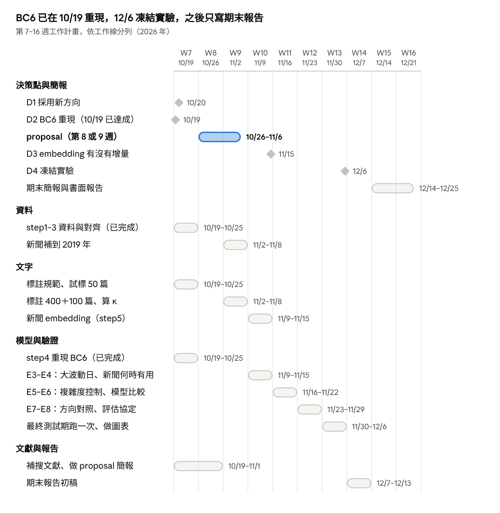

# 股票新聞專題：期中 Proposal 重點整理

Oct 20, 2026

> 2026-10-20 從 Claude Docs 匯出的版本。之後這份文件改名為「proposal 前可行性測試報告」，只保留 base case 跑過的結果。

我們的題目是用盤前新聞預測台股當天的波動，漲跌方向只當對照組。BC6 用台股真實資料顯示波動預測做得出來；新聞的增量只出現在財報、營收公布日，而且只有中覆蓋組顯著。proposal 在第 8 或第 9 週（12 分鐘報告加 3 分鐘問答），BC6 的主表已在組內重現。

## 目前進度：Base case

六個 base case 都已完成。最關鍵的 BC6 用台股真實資料確認新方向可行，10/19 組內已用 starter 程式重現，結論全部一致。

| 編號 | 資料 | 回答的問題 | 主要結論 |
| --- | --- | --- | --- |
| BC1 | 理論計算＋模擬 | 方向預測要多少資料才能證明有效 | 準確率 52% 要 3,863 筆獨立預測；30 檔股票、同日相關 0.25 時約要 4.3 年 |
| BC2 | 合成市場 | 資訊時點和切分方式會不會造成假準確率 | 同一批新聞，日曆日對齊有 73.5%，換成真正能交易的報酬只剩 51.0% |
| BC3 | StockNet 美股推文 | 真實資料上的方向預測 | 時間切分下贏不了「都猜漲」；隨機切分會高估 1.5–3.6 個百分點 |
| BC4 | 鉅亨網 24 天抽樣 | 新聞量和發布時段 | 已被 BC6 的完整兩年資料取代 |
| BC5 | StockNet 美股推文 | 改預測波動之後 | 只用過去波動 R² 0.30，加大盤 0.35（R² 對照訓練期平均，和 BC6 主表的算法不同）；推文的增量只有約 +0.001 |
| BC6 | 鉅亨網兩年新聞 49,958 篇＋60 檔台股 | 新方向在台股做不做得出來 | 見下表 |

BC6 的主要數字（測試期 2025-10 到 2026-09；R² 每月重新訓練，AUC 和方向用固定切分）。

| 項目 | 權值股組（20 檔） | 中覆蓋組（40 檔） | 組內重現（權值股／中覆蓋） |
| --- | --- | --- | --- |
| 振幅 R²：只用該股過去的振幅（M0，HAR） | 0.274 | 0.263 | 0.277／0.265 |
| 振幅 R²：再加大盤、行事曆、美股夜間行情（M1） | 0.300 | 0.279 | 0.306／0.287 |
| 再加新聞篇數（M2）的 ΔR² | +0.0001 | +0.0006 | −0.0006／+0.0001 |
| 財報／營收新聞日：M1 → 加兩個關鍵字旗標的 R² | 0.150 → 0.173（不顯著） | 0.107 → 0.209（ΔR² +0.10，CI 0.05–0.16） | 0.138 → 0.158（不顯著）；0.129 → 0.207（ΔR² +0.08，CI 0.02–0.13） |
| 大波動日的 AUC（M1） | 0.655 | 0.660 | 0.667／0.702 |
| 方向準確率／「每天都猜跌」的準確率 | 52.1%／52.1% | 55.1%／55.5% | 51.1%／52.2%；55.0%／55.4% |

- 中覆蓋組：不在市值前 20 大、2024-10 到 2025-09 有 10–60% 的交易日出現盤前新聞的 40 檔。R² 的基準是各股自己在測試期的平均。
- 美股夜間報酬預測加權指數的開盤跳空方向有 82.6% 準，預測開盤後到收盤只剩 51.0%（重現：80.9%、53.1%）。
- 重現結果：五個預期全部重現。差最多的是中覆蓋組財報／營收日的增量，從 +0.10 降到 +0.08，信賴區間仍不含 0。數字不完全一樣，是因為股價改用 FinMind、大盤特徵改用股票平均、除權息日改用參考價。
- 還沒做：事件類型關鍵字的人工驗證、真正的 embedding（step5 流程已測通；預設模型 EmbeddingGemma 要先在 Hugging Face 登入並同意授權）、公告日行事曆 baseline、新聞補到 2019 年。
- 10/19 另外補跑了簡單 baseline（歷史平均、昨天的振幅、EWMA 等），HAR 都明顯比較好，見第 5 節。

**BC5 和 BC6 怎麼比**

- R² 的絕對值不能直接比。BC5 對照訓練期平均，BC6 主表對照測試期平均，後者嚴格很多；用 BC5 的算法，重現的 M1 是 0.52／0.57，比 BC5 的 0.35 還高。市場、期間、目標（BC5 是美股的最高 ÷ 最低）也都不同。
- 比增量，兩者結論一致：加大盤（M0 → M1）都有增量（BC5 +0.05；BC6 +0.03／+0.02），加新聞篇數都約等於 0（BC5 +0.0004；BC6 −0.0006／+0.0001）。
- BC6 多看到財報、營收新聞日的增量：M1 在這些日子平均低估振幅（中覆蓋組約 11%），加關鍵字旗標後補回來。base case 的用途是找出增量在哪，正式實驗就往這裡做。

## 1. 題目（大綱第 1 項）

題目要包含文獻缺口和研究目的的關鍵詞，建議用：

- 英文：*Does Pre-Market News Predict Taiwan Stock Volatility Beyond Price History? A Leakage-Free Evaluation*
- 中文：盤前新聞能否在股價歷史之外預測台股波動？無資訊洩漏的評估

「pre-market news」「Taiwan」「volatility」對應研究目的；「beyond price history」「leakage-free」對應文獻缺口。

## 2. 研究問題與動機（大綱第 2 項）

我們問的是：開盤前能拿到的新聞，能不能在股價歷史和美股行情之外，多預測一點台股當天會動多大。

- **做什麼：** 每個交易日 08:45（開盤前），預測每檔股票當天的波動幅度、會不會是大波動日、成交量會不會異常放大。漲跌方向用同一套流程預測，當對照組。
- **怎麼做：** 新聞用三種方式表示：篇數、事件類型（關鍵字）、embedding。模型從 HAR（用過去波動做的線性迴歸）開始，一次加一類特徵，看每一類的增量。
- **為什麼不預測漲跌：** 公開資訊很快就反映在價格上。學術論文找到的報酬預測因子，發表後報酬平均少 58%（McLean & Pontiff 2016）。BC6 也看到：美股夜間行情能預測台股開盤跳空，開盤後就預測不了。
- **為什麼預測波動：** 波動會群聚，大波動之後常接著大波動（Engle 1982；Corsi 2009）。知道「會大動」不知道往哪動，沒辦法直接拿來賺錢，所以這種可預測性不會被交易掉。
- **用途：** 風險管理（VaR、保證金、部位上限）、選擇權定價、決定當天要不要降低曝險。
- **放進領域脈絡：** 財務學裡這類研究問的是新聞帶有多少資訊、價格多快反應、風險能不能預測。機器學習這邊則有評估方法的問題：很多「能預測」的結果來自資訊洩漏。
- **和原提案的關係：** 保留「新聞 → embedding」，只換預測目標。embedding 要用幾維，變成複雜度控制的問題，正好是這門課的核心。

## 3. 文獻缺口（大綱第 3 項）

美股已有研究在 HAR 之外估計新聞對波動的增量；台灣的中文新聞研究多半預測方向、報酬，或指數層級的恐慌指數。我們要補的是個股層級、以 HAR＋美股夜間行情為基準、在嚴格資訊時點下的中文新聞增量。

| 主題 | 已知的結果 | 代表文獻 |
| --- | --- | --- |
| 新聞與報酬方向 | 效果小，集中在小型股和短期；發表後、LLM 普及後變弱 | Tetlock (2007)；McLean & Pontiff (2016)；Lopez-Lira & Tang |
| 新聞與風險 | 文字加上歷史波動，比只用歷史波動好；新聞預測波動比預測方向容易 | Kogan et al. (2009)；Atkins et al. (2018) |
| 新聞與已實現波動（以 HAR 為基準） | 只用新聞贏不了波動歷史；加到 HAR 上有增量，新聞數量比語氣穩定，增益集中在高波動日 | Rahimikia, Zohren & Poon；Rahimikia & Poon |
| 台灣：中文新聞 | 多半預測漲跌方向或報酬，結果不一；新聞情緒和台指 VIX 有關，影響延續到隔天 | 吳昀錚（約 2007）；陳人華 (2016)；王釗東 (2017)；郭亭佑 (2021)；陳鵬仁 (2016)；呂樂憫 (2018)；Chuang et al. (2025) |
| 財報公布 | 公司越大、事前資訊越多，財報公布時的價格反應越小 | Atiase (1985) |
| 波動預測的基準 | 波動群聚；HAR 簡單又難打敗；比較波動預測要選對損失函數 | Engle (1982)；Corsi (2009)；Patton (2011) |
| 跨市場 | 美股對台股開盤有外溢效果 | Tsai (2008，交大碩士論文) |
| 評估方法 | 很多「能預測」的結果來自時間洩漏、隨機切分或多重比較 | Kapoor & Narayanan (2023)；Harvey, Liu & Zhu (2016) |

我們要補的缺口：

1. 美股已有研究在 HAR 之外估計新聞的增量；台灣的中文新聞研究多半預測方向、報酬，或指數層級的恐慌指數。在個股層級、以 HAR＋美股夜間行情為基準、在嚴格資訊時點下估計中文新聞的增量，目前找到的很少。proposal 前要在臺灣博碩士論文系統和華藝做系統性搜尋，再下定論。
2. 台灣的營收、財報公告日：BC6 的新聞增量集中在這些日子。要確認效果來自新聞內容，還是只要知道「今天有公告」就夠了（見第 5 節的公告日 baseline）。
3. embedding 有幾百維，有效樣本只有幾百個交易日。維度和正則化怎麼選，文獻很少討論。

查核程度：表中文獻多半只讀過摘要；Fama、Engle、Corsi、Tetlock 等經典沒有重新查閱。proposal 前，每篇至少讀摘要和結論，主要引用的 3–5 篇要讀全文。

## 4. 研究目的、問題與假設（大綱第 4 項）

研究目的：量化盤前新聞對台股當天波動的增量，找出它在哪些日子、哪些股票有用，並建立一套沒有資訊洩漏的評估流程。

- **RQ1 新聞的增量：** 在股價歷史、美股夜間行情、行事曆之外，新聞（篇數、事件類型、embedding）能改善多少？集中在哪些日子、哪些股票？
- **RQ2 複雜度控制：** 有效樣本只有幾百個交易日時，embedding 該用幾維、正則化多強？時間分塊 CV 和隨機 CV 選出來的一樣嗎？
- **RQ3 方向對照：** 同樣的輸入預測漲跌，能不能顯著超過多數類別？評估方式出錯會高估多少？

| 假設 | 內容 | 目前依據（BC6，組內重現一致） |
| --- | --- | --- |
| H1 | 只用股價歷史和美股資訊，就能解釋可觀比例的當天波動 | R² 0.28–0.30 |
| H2 | 新聞的整體增量很小 | ΔR² 約 0 |
| H3 | 增量集中在財報、營收新聞的日子 | 中覆蓋組 ΔR² +0.10（重現 +0.08） |
| H4 | 新聞覆蓋越少的股票，新聞日的增量越大 | 中覆蓋組 +0.10（重現 +0.08），權值股組 +0.02（不顯著） |
| H5 | 預測方向的準確率在 50% 附近；美股資訊只能預測開盤跳空 | 跳空 82.6%、盤中 51.0% |

大綱要回答的四個問題：

| 問題 | 本專題 |
| --- | --- |
| 需要知道什麼 | 各模型的樣本外 R²、AUC 和信賴區間；新聞增量在各種日子、各組股票的差異 |
| 怎麼查 | 一次加一類特徵的巢狀模型，walk-forward 評估，以交易日重抽算信賴區間 |
| 量化或質性 | 量化研究；人工標註只用來驗證事件分類規則 |
| 資料怎麼蒐集 | 爬鉅亨網新聞；FinMind 抓台股、yfinance 抓美股；全部公開、免費（見第 5 節） |

## 5. 研究方法（大綱第 5 項）

資料拿得到也夠用：兩年新聞 35 分鐘抓完、零錯誤；波動預測用兩年資料，主要結果的信賴區間就離 0 很遠。老師最在意資料，簡報建議給資料 2 頁。

**資料來源與規模（實測）**

| 資料 | 來源 | 規模 |
| --- | --- | --- |
| 台股新聞 | 鉅亨網 tw\_stock 類別 | 2024-09-30 到 2026-09-30 共 49,958 篇；補到 2019 年再多約 14 萬篇 |
| 台股日線、除權息與分割參考價、交易日曆 | FinMind（數字和證交所一致） | 60 檔，約 180 次請求、5 分鐘 |
| 美股夜間行情 | yfinance：Nasdaq、費半、S&P 500、VIX、台積電 ADR、NVDA | 6 個代碼 |

**資料夠不夠**

- 波動：夠。兩年約 490 個交易日，主要結果的信賴區間是 0.24–0.35。
- 方向：不夠。準確率 52% 要好幾年的測試資料才證明得了（BC1），所以只當對照組。
- 有效樣本要用交易日算：同一天的股票會一起動，兩年的 27,634 筆（股票，交易日）不能當成獨立樣本。
- 分組後樣本變少：測試期的財報／營收日，中覆蓋組只有 512 筆、權值股組 397 筆；新聞補到 2019 年可以縮小信賴區間。

**品質問題與處理**（證交所、FinMind、鉅亨網、Yahoo 四個來源交叉比對找到的）

- Yahoo 的台股成交量比證交所少 17–22%，停牌期間還補了假資料 → 台股改用 FinMind。
- 漲跌停鎖死的日子最高價等於最低價 → 目標用「真實振幅」，把前一天收盤價也算進去。
- 除權息、分割會造成假的漲跌 → 前一天收盤改用交易所參考價，分割前的成交量換算成分割後的股數。
- FinMind 的新聞時間是 UTC → 轉成台北時間，step3 有自我測試。
- 鉅亨網的美股個股缺 13–14 天，包含大行情的日子 → 美股用 yfinance。
- 已下市的股票（2888 新光金）Yahoo 查不到 → 名單用期初資訊決定，下市股票保留到下市日，避免存活者偏誤。
- FinMind 在股票沒交易的日子會回傳開高低收量全是 0 的列（60 檔共 6 列），會讓模型直接出錯 → step1 已改成自動刪除（重現時發現）。

**決策時點（避免資訊洩漏）**

| 新聞時段（台北時間） | 範圍 | 用途 |
| --- | --- | --- |
| 盤前 | 前一個交易日 13:30 到當天 08:45 | 當天的特徵 |
| 開盤前 15 分鐘 | 當天 08:45–09:00 | 不使用 |
| 盤中 | 當天 09:00–13:30 | 當天不能用，隔天才當特徵；另外拿來做洩漏對照 |

- **為什麼是 08:45：** 08:30–09:00 是盤前委託時間，09:00 開盤撮合。08:45 出預測，還有 15 分鐘可以下單或調整部位；也替新聞的時間戳留幾分鐘緩衝，避免混進開盤後的資訊。
- **捨棄的新聞很少：** 兩年裡 08:45–09:00 只有 165 篇（全部新聞的 0.3%），分散在 486 個交易日中的 128 天。
- **可能被問到：** 證交所 08:30 起揭示試撮的模擬成交價和最佳五檔。08:45 時已經有 15 分鐘的試撮資訊，我們沒用，因為目前的資料來源沒有歷史試撮紀錄。時點如果改到 09:00，就該拿試撮價當對照。

**模型與評估**

- 巢狀模型：HAR → ＋大盤、行事曆、美股 → ＋新聞篇數 → ＋事件類型 → ＋embedding（PCA 取 k 維）。
- 模型族：ridge／lasso 為主，SVR、LightGBM、kNN 對照；複雜度的旋鈕是 embedding 維度 k 和正則化 λ。
- 切分：walk-forward，每個月用之前所有資料重新訓練、預測下個月；最後 12 個月保留到期末只跑一次。
- 指標：樣本外 R²（基準是各股自己的平均）、大波動日 AUC、QLIKE；信賴區間以交易日為單位 bootstrap。
- 選參數：比較時間分塊 CV、隨機 CV、FPE／Schwartz 準則選到的 k 和 λ（RQ2）。

**Baseline（新聞模型要贏過誰）**

| 方法 | 說明 | 權值股 R² | 中覆蓋組 R² |
| --- | --- | --- | --- |
| 歷史平均 | 該股之前所有日子的平均 | −0.30 | −0.37 |
| 昨天的振幅 | 前一天的對數真實振幅 | −0.08 | −0.08 |
| 前 5 天平均 | 最近一週的平均 | 0.23 | 0.20 |
| 前 22 天平均 | 最近一個月的平均 | 0.20 | 0.18 |
| EWMA（λ = 0.94） | 越近的日子權重越大的平均 | 0.23 | 0.20 |
| M0：HAR | 前 1 天、前 5 天、前 22 天平均振幅的線性迴歸 | 0.28 | 0.27 |
| M1：HAR＋大盤＋美股 | 新聞模型要贏過的對象 | 0.31 | 0.29 |

- R² 的比較基準是各股測試期的平均，只算同一檔股票不同日子之間的差異。歷史平均是負的，因為測試年的波動比之前高。
- HAR 比最好的簡單方法 EWMA 多 0.045（權值股）、0.061（中覆蓋組），信賴區間都不含 0；M1 再多 0.02–0.03。
- 方向對照的 baseline 是測試期的多數類別：開盤到收盤下跌的日子占 52%（權值股）、55%（中覆蓋組），每天都猜跌就有這個準確率。
- 還要補一個：營收、財報公告日的行事曆旗標。公告日期事先就知道，新聞要贏過「M1＋公告日」，才能說增量來自新聞內容。

**怎麼看 R²、怎樣算成功**

- R² = 1 − 模型的平方誤差 ÷ 基準的平方誤差：越高越好，小於 0 代表比基準還差。只有同一批測試日、同一個目標、同一個基準，才能互相比。
- 換基準，數字就差很多：同一個 M1（權值股），對照測試期平均是 0.31，對照過去的平均是 0.47；用 BC5 的算法（固定切分、對照訓練期平均）是 0.52。
- 只看樣本外。高得不合理先查洩漏：偷看當天盤中新聞的 LEAK 模型，R² 比 M2 高 0.012–0.015，但 08:45 拿不到那些新聞。
- 成功標準：同一批測試日上，新聞模型減 M1 的 ΔR²，信賴區間不含 0。只看財報、營收新聞日時，M1 在這些日子只有 0.13–0.14，要和這個比；還要贏過「M1＋公告日」，才算新聞內容的貢獻。

**標註**

- 預測目標從股價直接算，不需要標註。
- 兩年全部新聞人工標要 416–624 小時，不可行。只抽 400 篇，其中 100 篇兩人重複標（約 4–6 小時），用來驗證事件類型的關鍵字規則，並算 Cohen's κ。
- 不用聊天機器人代標。要把分類擴大到全部新聞，就用人工標註訓練自己的小分類器。

**和課程的對應：** 迴歸（主任務）、分類（大波動日）、正則化與複雜度控制（set03）、SRM（embedding 維度的巢狀結構）、只估計正負號（方向對照，set02 p.59）。

## 資源、倫理與法規（大綱第 5 項的清單）

老師列的項目都有答案：預算 0 元、不涉及受試者，只有新聞著作權要注意。

| 老師的項目 | 本專題 |
| --- | --- |
| 需要多少時間 | 第 7–16 週（見「接下來幾週」）。資料蒐集約 3 小時（電腦掛著跑），人工標註約 6 小時 |
| 設備與場地 | 個人電腦即可，主要模型在 CPU 上跑；embedding 用組員的 GPU 或 Kaggle 免費 GPU |
| 合作 | 組內依四條工作線分工；不需要校外合作；程式放公開的 GitHub repo [ucucucucuccu/stock\_basecase](https://github.com/ucucucucuccu/stock_basecase) |
| 預算 | 0 元：鉅亨網、FinMind、證交所、Yahoo 和所有軟體都免費 |
| 動物研究 | 不涉及 |
| 需要的訓練 | 時間序列的切分與驗證、ridge／lasso（課程會教）；embedding 模型的用法、bootstrap（starter 程式有範例） |
| 法規 | 著作權法第 9 條只排除「單純傳達事實」的新聞，財經新聞多有分析，視為受保護：原文只放組內，報告只放統計結果和改寫過的例子。爬蟲限速（每次請求間隔 1 秒），網站要求停止就停 |
| 倫理與保密（涉不涉及人） | 不涉及受試者和個資；人工標註由組員自己做；不做真錢交易，也不提供投資建議 |
| 需不需要倫理審查 | 不需要 |
| 資料夠不夠 | 波動預測夠，方向預測不夠（見第 5 節） |
| 怎麼保密 | 新聞原文存在組員自己的電腦或私人雲端，不進 repo；公開的只有程式和統計結果 |
| 健康與安全 | 不適用 |

## 6. 預期成果（大綱第 6 項）

不管新聞最後有沒有幫上忙，期末都有站得住的結論；負面結果也照實報告。

**會交出的東西**

1. 對齊好的資料集：60 檔台股、兩年以上的日資料、盤前新聞特徵、美股夜間特徵，附資料品質報告。
2. 一套無洩漏的評估流程：walk-forward、以交易日重抽的信賴區間、洩漏對照。
3. 主結果表：HAR → ＋美股 → ＋新聞篇數 → ＋事件類型 → ＋embedding；三個目標（振幅、大波動日、成交量）；兩組股票。
4. 複雜度控制的驗證曲線（embedding 維度 × 正則化），以及三種選參數方法的比較。
5. 方向對照組，以及「評估方式出錯會高估多少」的比較。

**預期看到的結果**（對應 H1–H5）

| 預期 | 把握 | 依據 |
| --- | --- | --- |
| 股價歷史和美股資訊就能解釋可觀比例的當天波動 | 很高 | BC6、BC5 |
| 新聞的整體增量很小 | 很高 | BC6、BC5 |
| 新聞在財報、營收日有用，中覆蓋組比權值股明顯 | 高，待人工驗證關鍵字、補公告日 baseline | BC6 |
| embedding 能不能贏過兩個關鍵字旗標 | 未知 | 有效樣本少，簡單特徵可能比較好；這本身就是複雜度控制的結論 |
| 方向預測接近隨機，美股資訊只能預測開盤跳空 | 很高 | BC6、BC1–BC3 |

## 接下來幾週

這週四條線同時開工，BC6 已在 10/19 重現（D2 已過），proposal 用重現的數字。proposal 之後依序做 embedding、複雜度控制、方向對照，12/6 凍結實驗後只寫報告。

- D3 的分支：embedding 有增量，就做完整的複雜度曲線；沒有，就把重點放在事件類型和評估協定。
- 時間夠的話可以加做：用人工標註訓練「embedding → 事件類型」分類器套到全部新聞；加入公開資訊觀測站的重大訊息，和媒體報導比較；加 MLP 等非線性模型。

## 分工與待決定的事

5 人分四條工作線，模型與驗證的工作最多，由兩人負責；第 7 週結束前（10/25）每條線先交一樣東西。

| 工作線 | 負責內容 | 10/25 前要交的東西 |
| --- | --- | --- |
| 資料 | 股價與交易日曆、新聞爬取與對齊、品質檢查 | step1–step3（10/19 已完成） |
| 文字 | 事件類型的關鍵字規則、標註規範與 κ、embedding | 標註規範；試標 50 篇 |
| 模型與驗證 | HAR 基準、ridge／SVR／LightGBM、walk-forward、bootstrap | step4 重現 BC6 主表（10/19 已完成）；公告日行事曆 baseline |
| 文獻與報告 | 文獻缺口、簡報、方向對照組的論述 | 補搜中文文獻；簡報初稿 |

需要組內決定：

- [ ] 全組同意改成預測波動，漲跌方向當對照組（D1）
- [ ] 每條工作線的負責人
- [ ] 要不要先用一兩句話問老師這個設計，特別是「方向當對照組」
- [ ] 新聞要不要補到 2019 年：多約 14 萬篇、電腦掛著跑約 2.2 小時，可以讓財報／營收日的分組結果更穩

## 簡報頁面規劃（12 分鐘報告＋3 分鐘問答）

proposal 簡報占學期成績 25%（期末簡報 20%、書面報告 15%）。

| 頁 | 內容 | 時間 |
| --- | --- | --- |
| 1 | 題目、組員 | 0.5 分 |
| 2 | 動機：新聞與股價；為什麼改預測「動多大」 | 1 分 |
| 3 | 方向預測為什麼難：市場效率、McLean & Pontiff、BC6 跳空 82.6% vs. 盤中 51.0% | 1 分 |
| 4 | 文獻：文字與報酬、文字與波動 | 1 分 |
| 5 | 文獻：評估方法的問題（洩漏）＋研究缺口 | 1 分 |
| 6 | 研究目的、問題與假設 | 1 分 |
| 7 | 問題形式化：Cherkassky 的學習情境（產生器、系統、學習機器、損失）；決策時點 08:45 | 1 分 |
| 8 | 資料：來源、規模、怎麼蒐集；資料夠不夠 | 1.5 分 |
| 9 | 資料品質：四個來源交叉比對找到的問題與處理 | 1 分 |
| 10 | 方法與評估：模型、baseline 與成功標準、複雜度控制、時間切分、信賴區間 | 1 分 |
| 11 | 初步結果（BC6）與預期成果 | 1.5 分 |
| 12 | 資源、時程、倫理與風險 | 0.5 分 |

## 參考資料

詳細版是《股票新聞專題：開工前分析報告（第二版）》；程式、實驗設定和結果在 GitHub repo [ucucucucuccu/stock\_basecase](https://github.com/ucucucucuccu/stock_basecase)。

**文獻**

- Atiase, R. K. (1985). Predisclosure Information, Firm Capitalization, and Security Price Behavior Around Earnings Announcements. *Journal of Accounting Research*, 23(1), 21–36. [IDEAS](https://ideas.repec.org/r/bla/joares/v23y1985i1p21-36.html)
- Atkins, A., Niranjan, M. & Gerding, E. (2018). [Financial news predicts stock market volatility better than close price](https://eprints.soton.ac.uk/417880). *Journal of Finance and Data Science*, 4(2), 120–137.
- Corsi, F. (2009). A Simple Approximate Long-Memory Model of Realized Volatility. *Journal of Financial Econometrics*, 7(2), 174–196.
- Engle, R. F. (1982). Autoregressive Conditional Heteroscedasticity with Estimates of the Variance of United Kingdom Inflation. *Econometrica*, 50(4), 987–1007.
- Harvey, C. R., Liu, Y. & Zhu, H. (2016). … and the Cross-Section of Expected Returns. *Review of Financial Studies*, 29(1), 5–68.
- Kapoor, S. & Narayanan, A. (2023). Leakage and the reproducibility crisis in machine-learning-based science. *Patterns*, 4(9), 100804.
- Kogan, S., Levin, D., Routledge, B. R., Sagi, J. S. & Smith, N. A. (2009). [Predicting Risk from Financial Reports with Regression](https://aclanthology.org/N09-1031/). *NAACL-HLT 2009*, 272–280.
- Lopez-Lira, A. & Tang, Y. [Can ChatGPT Forecast Stock Price Movements? Return Predictability and Large Language Models](https://arxiv.org/abs/2304.07619). arXiv:2304.07619.
- McLean, R. D. & Pontiff, J. (2016). Does Academic Research Destroy Stock Return Predictability? *Journal of Finance*, 71(1), 5–32.
- Patton, A. J. (2011). Volatility forecast comparison using imperfect volatility proxies. *Journal of Econometrics*, 160(1), 246–256.
- Tetlock, P. C. (2007). Giving Content to Investor Sentiment: The Role of Media in the Stock Market. *Journal of Finance*, 62(3), 1139–1168.
- Tsai, C.-H.（2008）。[美國對台灣股市外溢效果之分量迴歸分析](https://ir.lib.nycu.edu.tw/handle/11536/43039)。國立交通大學碩士論文。
- Xu, Y. & Cohen, S. B. (2018). [Stock Movement Prediction from Tweets and Historical Prices](https://aclanthology.org/P18-1183/). *ACL 2018*.（StockNet 資料，BC3、BC5 使用）

**10/19 補查的文獻**

- Rahimikia, E., Zohren, S. & Poon, S.-H. [Realised Volatility Forecasting: Machine Learning via Financial Word Embedding](https://arxiv.org/abs/2108.00480). arXiv:2108.00480.
- Rahimikia, E. & Poon, S.-H. [Alternative Data for Realised Volatility Forecasting: Limit Order Book and News Stories](https://metatoc.com/papers/191599-alternative-data-for-realised-volatility-forecasting-limit-order-book-and-news-stories). *International Journal of Finance & Economics*（線上先行版）.
- Chuang, H.-M., He, H.-C. & Hu, M.-C. (2025). [Chinese Financial News Analysis for Sentiment and Stock Prediction: A Comparative Framework with Language Models](https://www.mdpi.com/2504-2289/9/10/263). *Big Data and Cognitive Computing*, 9(10), 263.
- 吳昀錚（約 2007）。[利用文字探勘技術預測台股加權指數之漲跌趨勢](https://etd.lib.ncu.edu.tw/detail/f97661b32d8308510e4bba937109c2b2)。國立中央大學碩士論文。
- 陳人華（2016）。[應用網路新聞文字探勘於預測台灣股價趨勢之研究](https://thesis.lib.nccu.edu.tw/detail/6934899ec97c9111ce16556bf41c2dbf/)。國立政治大學碩士論文。
- 陳鵬仁（2016）。[探討台指選擇權波動率指數與財經新聞之關聯性研究](https://thesis.lib.nccu.edu.tw/detail/60212f9b2f0edd35f757a0f1c317d9f1/)。國立政治大學碩士論文。
- 王釗東（2017）。[以大數據探究財經新聞對台灣股票市場表現之影響](https://tdr.lib.ntu.edu.tw/handle/123456789/68010)。國立臺灣大學碩士論文。
- 呂樂憫（2018）。[VIX與財務預警－數據分析觀點](https://thesis.lib.nccu.edu.tw/detail/8071a06e4d8ae74d7061b90766747815/)。國立政治大學碩士論文。
- 郭亭佑（2021）。[透過文字探勘預測台股報酬](https://thesis.lib.nccu.edu.tw/thesis/detail/b388207d80ba366428d5c82a8b659da9)。國立政治大學碩士論文。

**資料與法規**

- [FinMind](https://github.com/FinMind/FinMind)：台股日線、除權息、分割、交易日曆
- 鉅亨網新聞列表 API（非公開文件）：`https://api.cnyes.com/media/api/v1/newslist/category/tw_stock`
- [著作權法第 9 條說明](https://www.legis-pedia.com/article/Intellectual-property-rights/488)
- [集中市場交易制度介紹（臺灣證券交易所）](https://www.twse.com.tw/zh/products/system/trading.html)：盤前委託時間與試撮資訊揭示
- 課程：期中簡報大綱（general guideline for midterm presentation）、Syllabus 配分
